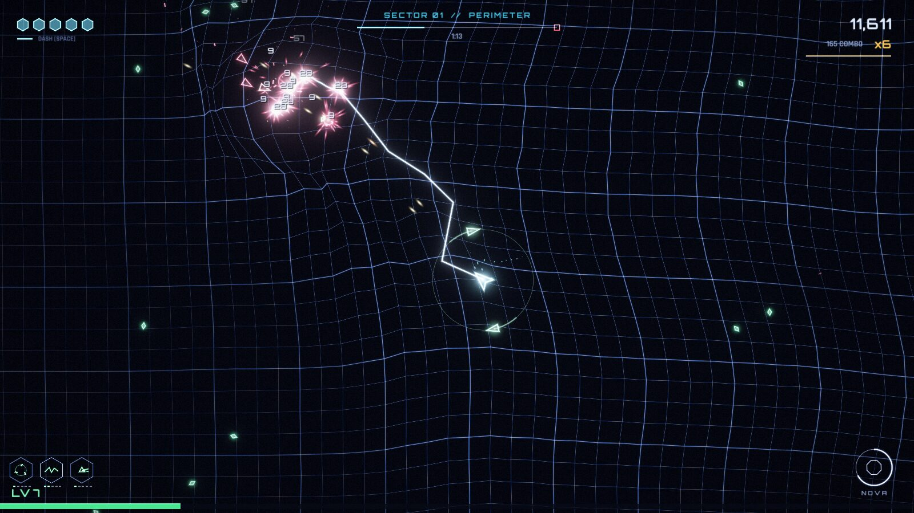
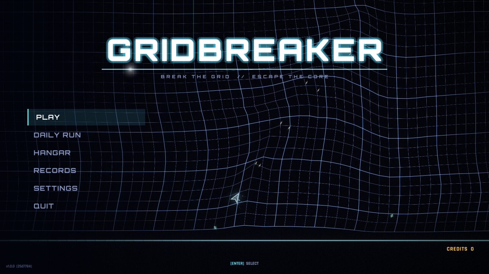
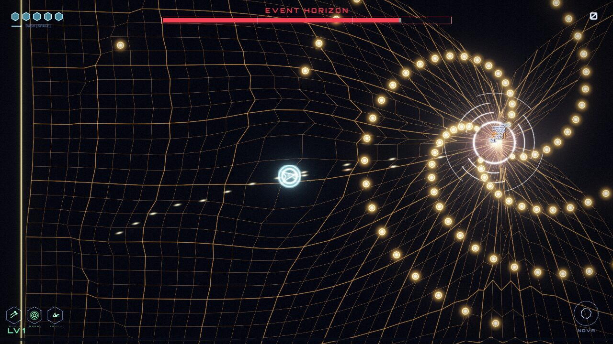
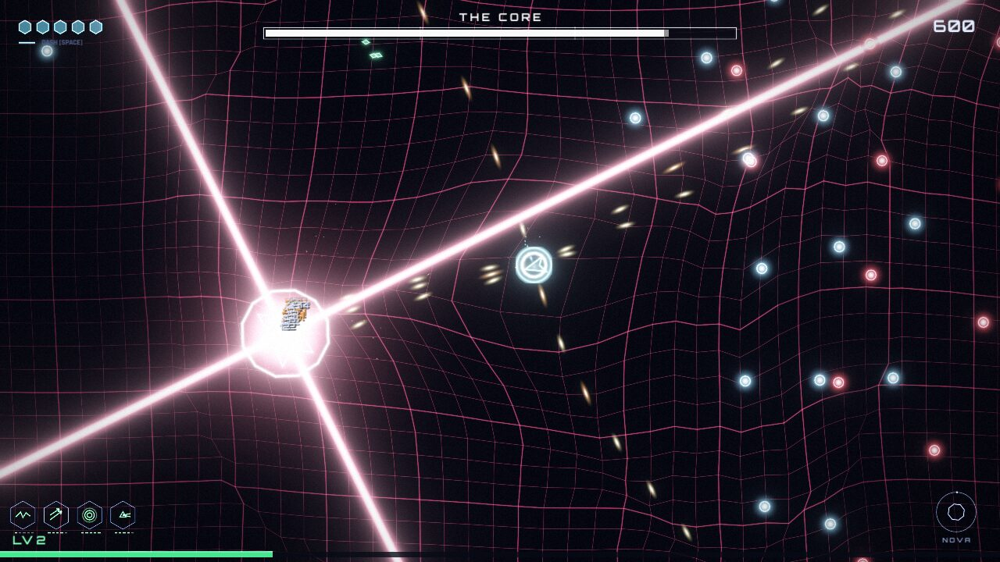
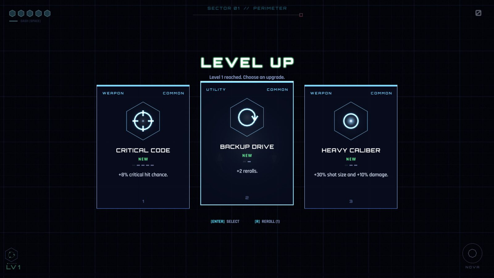
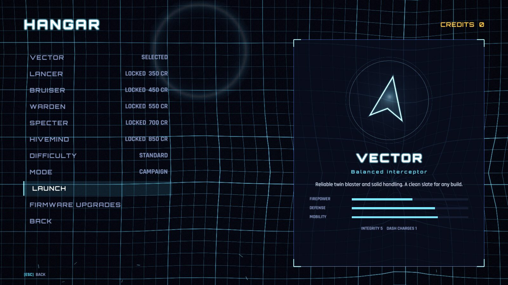
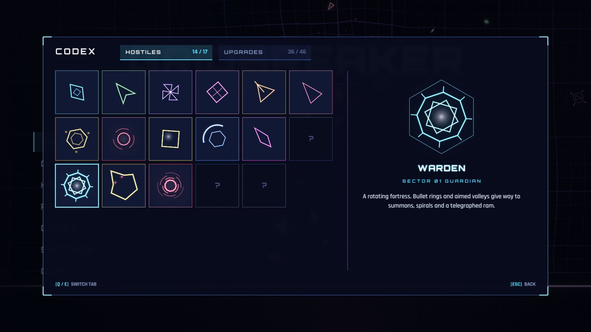
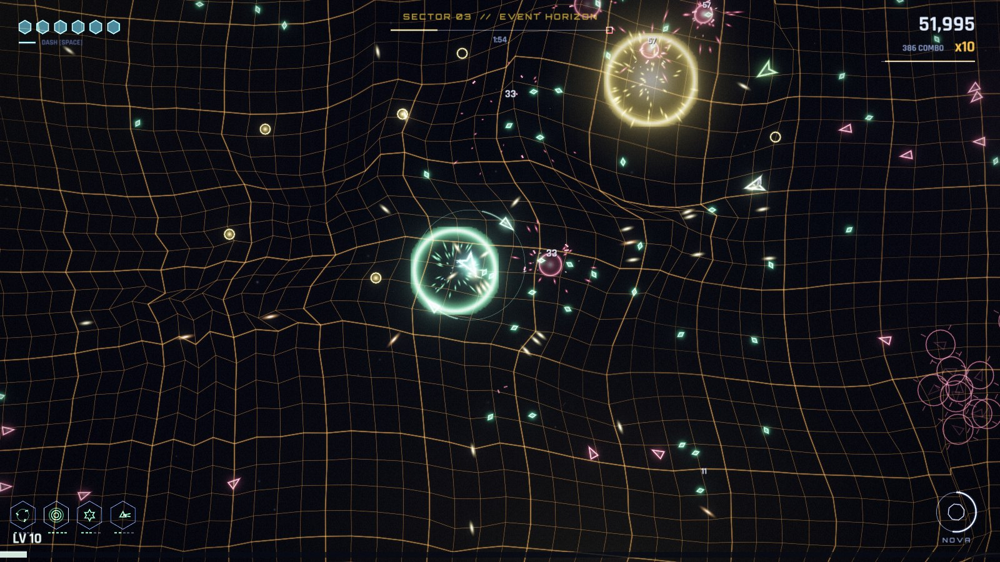
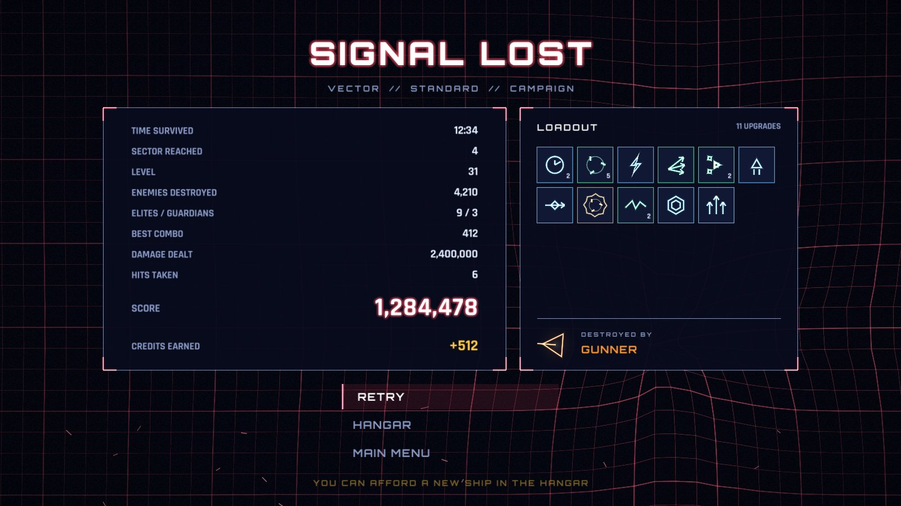

# GRIDBREAKER

**A neon twin-stick roguelite arena shooter.** You are a rogue process tearing your
way out of a corrupted mainframe, one sector at a time. Blast through waves of
geometric viruses, scoop up data shards, draft upgrades into an absurd build, and
take down five guardian bosses on a living, warping grid.



| | |
|---|---|
|  |  |
|  |  |
|  |  |
|  |  |

---

## Quick start (Windows 10/11)

1. Download `Gridbreaker-windows-x64.zip` from the [Releases](../../releases) page.
2. Extract it anywhere.
3. Run `Gridbreaker.exe`.

That's it: a single executable with every asset compiled in. No installer, no
runtimes and no DLLs. Any GPU with OpenGL 3.3 works, which covers every
integrated or discrete GPU from roughly the last decade.

The executable is not code-signed, so Windows SmartScreen may show "Windows
protected your PC" on first launch: click **More info**, then **Run anyway**.

Settings and progress are stored in `%APPDATA%\Gridbreaker`.

## Controls

| Action | Keyboard & mouse | Gamepad |
|---|---|---|
| Move | `W A S D` / arrow keys | Left stick |
| Aim | Mouse | Right stick |
| Fire | Left mouse button (or enable *Auto-fire*) | Right stick / right trigger |
| Dash (brief invulnerability) | `Space` / `Shift` / right mouse | Left trigger / `A` |
| Nova (screen-clearing blast, charges from kills) | `Q` / `E` / middle mouse | Bumpers / `B` |
| Pause | `Esc` / `P` | `Start` |
| Pick upgrade | Mouse, `1` `2` `3`, arrows + `Enter` | D-pad + `A` |
| Reroll upgrades | `R` | `Y` |
| Toggle fullscreen | `F11` / `Alt+Enter` | |

Prompts adapt automatically to whichever device you used last.

## How a run works

* **Five sectors, five guardians.** Each sector is a timed onslaught. Survive the
  timer and the sector's guardian boss arrives. Destroy it to move on.
* **Shards → levels → upgrades.** Destroyed enemies drop data shards. Every
  level-up pauses the action and offers three upgrade cards (common → legendary).
  Elites drop *data caches* with rarer cards.
* **Sector events.** Every forty seconds or so a sector stages a set piece: an
  ambush ring closing in, a crossfire line of darts, or a storm of free data.
* **Build expression.** 39 upgrades: weapon mods (split shot, ricochet, frag,
  cryo, seeker rounds...), defences (deflector shield, reactive armour,
  auto-repair), mobility, utility and seven levelled **weapon modules**: Orbit
  Blades, Wingmen drones, Arc Coil chain lightning, Swarm Missiles, Pulse Nova,
  Proximity Mines and the Prism Lance. You can run up to four modules at once.
* **Evolutions.** Max out a module while owning its catalyst upgrade and a
  legendary evolution appears: Orbit Blades + Thrusters become *Saw Storm*,
  Wingmen + Split Shot become *Hive Swarm*, and five more to discover. Module
  cards tell you which catalyst they need.
* **Routing.** After each guardian you choose a protocol for the next sector:
  more enemies for more experience, tougher enemies for more score, a free
  upgrade cache, or a breather.
* **Score attack.** Chain kills to build a combo multiplier (up to x10). Getting
  hit resets it.
* **Challenges and records.** Sixteen goals (beat each guardian, flawless
  sectors, huge combos...) pay out bonus credits. Records keep your best scores
  and your last ten runs, and every results screen shows your final loadout and
  what destroyed you.
* **Codex.** Every hostile you meet and every upgrade you draft is decoded in
  the title-screen codex, with tactics, base stats and evolution recipes. Its
  *Guide* tab explains every mechanic in a page each.
* **Meta-progression.** Runs earn credits. Spend them in the **Hangar** to unlock
  five more ships (each with its own weapon and starting kit) and permanent
  firmware upgrades.

### Modes and difficulty

* **Campaign:** clear five sectors and destroy the Core. Optionally keep going
  in endless mode afterwards.
* **Endless:** sectors loop forever. Each loop compounds enemy toughness and
  numbers, and *corruption* makes destroyed hostiles fire back.
* **Boss rush:** the five guardians back to back. You start with fourteen
  upgrades and draft eight more after every kill. Great for a quick session.
* **Daily run:** a fixed seed and ship for everyone each day.
* **Relaxed / Standard / Overclocked:** Relaxed adds two integrity and softens
  enemies; Overclocked is denser and faster, with bigger rewards.

### Tips

* Enemies telegraph everything: spawn rings, Dart lock-on lines and laser
  guides all warn you before they hurt you.
* Dashing makes you invulnerable for a moment; dash *through* danger.
* Nova clears every enemy bullet on screen. Save it for a boss's worst attack.
* Shielders block shots from the front: flank them or use piercing shots.
* Serpent (Weaver) bodies absorb bullets; aim for the head.

## Features at a glance

* HDR rendering with a six-level physically inspired bloom chain, tone mapping,
  chromatic aberration, vignette and film grain, all built on raylib.
* Spring-mass warp grid that ripples under explosions, bullets and gravity wells,
  over a parallax backdrop with its own motif per sector (radar sweeps, data
  rain, an accretion disk, a firewall lattice, the Core's heartbeat).
* Thousands of particles, hit-stop, slow motion, screen shake and flashes, all
  tunable in Settings (with a *Reduce flashing* option).
* 100% procedural audio: every sound effect is synthesised at startup, and the
  music is a real-time adaptive synthwave sequencer whose layers follow the
  action, change key per sector and switch to boss/victory themes.
* Attract-mode title screen: an AI pilot plays the game live behind the menu.
* Full keyboard, mouse and gamepad support, including gamepad aim assist.
* Borderless fullscreen by default, V-Sync, resolution-independent UI.
* Automatic render scale: the scene buffer is capped on very high resolutions
  and steps down further if a weak GPU cannot hold ~50 fps (the UI always stays
  at native resolution). A fixed scale can be chosen in Settings.

## Building from source

The build uses CMake and fetches its two dependencies automatically (raylib
5.5 and, for tests, doctest).

### Windows (Visual Studio 2022 or Build Tools)

```bat
cmake -S . -B build -A x64
cmake --build build --config Release
build\bin\Gridbreaker.exe
```

The executable links the C runtime statically, so it runs on a clean Windows
install.

### Linux

```sh
sudo apt install build-essential cmake ninja-build libx11-dev libxrandr-dev \
                 libxinerama-dev libxcursor-dev libxi-dev libgl1-mesa-dev libasound2-dev
cmake -S . -B build -G Ninja -DCMAKE_BUILD_TYPE=Release
cmake --build build
./build/bin/Gridbreaker
```

### Tests and tools

```sh
ctest --test-dir build --output-on-failure      # unit + simulation tests
./build/gridbreaker_balance 4 1500 1 0.6         # bot balance runs: runs, seconds, difficulty 0-2, skill 0-1
./build/gridbreaker_balance 2 900 1 0.45 bossrush # ...optionally in endless or bossrush mode
./build/gridbreaker_audiodump out/ 20            # render music and SFX to WAV files
```

### Command-line options

| Option | Purpose |
|---|---|
| `--windowed`, `--size WxH` | Start in a window |
| `--no-audio` | Disable audio output |
| `--autotest SECONDS` | Let the AI pilot play a run, then exit (used by CI) |
| `--screenshot PATH --screenshot-at SECONDS` | Capture a screenshot and exit |
| `--seed N` | Fixed run seed |
| `--data-dir PATH` | Override the save/settings directory |
| `--sector N`, `--boss` | Start runs at a later sector, or straight at its guardian |
| `--scene NAME` | Jump to `title`, `game`, `bossrush`, `hangar`, `codex`, `records`, `results`, `draft`, `pause`... |
| `--perf` | Show the performance overlay (toggle in game with `F3`) |

## Continuous integration

Every push is built by GitHub Actions:

* **Windows (MSVC, x64):** warnings as errors, unit tests, a check that the
  executable has no VC++ redistributable dependency, and a smoke test that runs
  the real `.exe` with the AI pilot under Mesa's software OpenGL.
* **Linux (GCC):** warnings as errors, a `clang-format` style check (see
  `.clang-format`), unit tests, and a 90-second bot smoke test under a virtual
  display.
* **Sanitizers:** the unit tests and headless bot runs of every mode are also
  built with AddressSanitizer and UndefinedBehaviorSanitizer.
* A rolling *nightly* pre-release is published from the latest build; tagged
  versions publish a proper release.

## Project layout

```
src/core     App loop, scenes, input, settings, storage, math, RNG, embedded assets
src/render   Neon line/sprite batcher, HDR bloom post-processing, warp grid, particles, camera, text
src/audio    Sound-effect synthesiser, real-time music engine, audio device/voice management
src/game     Simulation: world, enemies, bosses, weapon modules, upgrades, ships, director, bot, profile
src/view     Presentation of the simulation: world renderer, effects director, HUD, shapes
src/ui       Widgets, upgrade draft, settings, codex and records panels
src/scenes   Title, hangar, game and results screens
assets       Fonts (OFL), GLSL shaders, icon; all compiled into the executable
tests        doctest unit and headless simulation tests
tools        Balance simulator and audio renderer
docs         Design notes and screenshots
```

The simulation (`src/game`) never touches rendering or audio. It emits events
that the presentation layer turns into particles, sound, shake and grid forces.
That separation is what makes the headless tests, the balance simulator and the
attract-mode demo possible.

See [docs/DESIGN.md](docs/DESIGN.md) for design notes.

## Credits & licenses

* Code: MIT (see `LICENSE`).
* [raylib](https://www.raylib.com/) by Ramon Santamaria and contributors (zlib).
* Fonts: [Orbitron](https://github.com/theleagueof/orbitron) and
  [Rajdhani](https://fonts.google.com/specimen/Rajdhani), SIL Open Font License 1.1
  (`assets/fonts/OFL-*.txt`).
* All graphics, sound effects and music are generated procedurally by the game.
